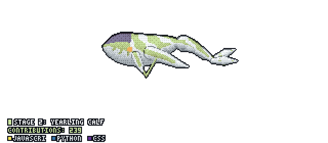

<h1 align="center">Hey, I'm Vaibhav Sharma </h1>

<h3>💻🦉 Night Owl | Day Dreamer</h3>

🎓 Final-year ECE student who looked at hardware and decided software was less likely to catch fire 
☕ Backend + AI engineer: `Java` by loyalty, `Python` by necessity 
🤖 I build RAG systems that say “I don't know” when they don't know, unlike most of us in a group discussion 
🛠️ Currently building: APIs, AI agents, and the occasional robot (yes, with real wires) 
🏆 Hackathon regular: turning caffeine and deadlines into working demos 
📊 Ex-Tech Mahindra intern: made process bottlenecks visible, which, unlike mine, are fixable 
🚀 **Stack:** `Java`, `Spring Boot`, `Python`, `FastAPI`, `Node.js`, `PostgreSQL`, `Redis`, `LangChain` 
💬 **Ask me about:** backend design, RAG pipelines, or why my code “works on my machine” 
📫 **Reach me:** [winterhell823@gmail.com](mailto:winterhell823@gmail.com)

 

  
  
  
  
  
  
  
  
  
  
  
  
  
  

  

